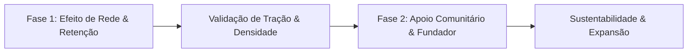

# 🗺️ Roadmap Estratégico — Projeto Sentinela

Este documento detalha o plano de evolução do **Sentinela**, definindo os objetivos, funcionalidades e marcos de desenvolvimento para as **Fases 1 e 2**, focadas no crescimento orgânico, retenção de utilizadores e início da sustentabilidade comunitária sem recurso a anúncios.

---

---

## 📍 Fase 1 (Fase Atual): Efeito de Rede & Crescimento Orgânico

### 🎯 Objetivo Principal
Garantir que a aplicação é indispensável no quotidiano dos utilizadores, maximizando a densidade de alertas reais na cidade. Em segurança comunitária, **o valor da app cresce exponencialmente com o número de utilizadores ativos** (*efeito de rede*).

> [!IMPORTANT]
> **Princípio da Fase 1:** Toda a aplicação permanece 100% gratuita, aberta e sem qualquer fricção de entrada, permitindo criar rapidamente massa crítica de utilizadores em cidades-piloto (ex.: Porto e Lisboa).

---

### 📦 Funcionalidades Existentes (Base Sólida)
* [x] Mapa com estilo escuro e cálculo de percursos pedestres e automóveis (Valhalla / OSRM).
* [x] Algoritmo de desvio inteligente que contorna incidentes e ruas escuras.
* [x] Modo de Simulação de Percurso passo a passo para planeamento prévio.
* [x] Sinalização de 7 categorias de perigo com validação e resolução comunitária.
* [x] Modo «Estou a ser seguido» com transmissão do trajeto em direto para Sentinelas.
* [x] Botão de Emergência SOS com envio automático de coordenadas e morada para contactos e 112.
* [x] Mapeamento de farmácias com horários dinâmicos e esquadras policiais (PSP/GNR).

---

### 🚀 O Que Esperamos Implementar na Fase 1

#### 1. Mecanismo de Convite e Partilha Rápida («Adiciona um Sentinela»)
* **Problema:** Para o modo «Estou a ser seguido» e SOS funcionarem no seu potencial máximo, os contactos de confiança também devem ter a app instalada.
* **Solução:**
  * Criação de um link de convite rápido via WhatsApp e SMS com mensagem personalizada:
    > *«Olá! Adicionei-te como meu contacto de confiança no Sentinela para podermos acompanhar os nossos trajetos à noite. Instala a app aqui: [link]»*
  * Emparelhamento automático: ao abrir o link, os dois utilizadores ficam automaticamente ligados como Sentinelas mútuos.

#### 2. Onboarding Interativo de 3 Passos
* **Problema:** Novos utilizadores precisam de compreender de imediato o conceito preventivo da app logo na primeira abertura.
* **Solução:**
  * Apresentação visual limpa na primeira abertura:
    1. *Rotas que protegem:* como o mapa evita perigos.
    2. *Comunidade ativa:* como reportar e confirmar alertas.
    3. *Rede de Sentinelas:* como configurar os contactos de emergência.

#### 3. Reputação Cívica e Gamificação Positiva («Guardião Local»)
* **Problema:** Incentivar os utilizadores a reportarem com regularidade e com rigor.
* **Solução:**
  * Sistema de pontuação comunitária invisível a spammers:
    * +1 ponto por reporte confirmado por outro utilizador.
    * Níveis cívicos no perfil: *Explorador* (nível 1), *Vigilante* (nível 2), *Guardião do Bairro* (nível 3).
    * Notificação de impacto positivo: *«O teu alerta ajudou 14 vizinhos a evitar uma rua escura ontem à noite!»*

#### 4. Otimização Contínua de Desempenho e Bateria
* **Solução:**
  * Gestão ultra-eficiente do sensor GPS em segundo plano para que o rastro ao vivo consuma menos de 3% a 4% de bateria por hora de caminhada.

---

### 📊 Métricas de Sucesso da Fase 1 (Critérios para avançar para a Fase 2)
1. **Densidade de Dados:** Pelo menos 15 a 25 reportes comunitários ativos validados semanalmente numa cidade piloto.
2. **Retenção:** Utilizadores abrem a app pelo menos 3 vezes por semana em deslocações noturnas ou regressos a casa.
3. **Rede:** Pelo menos 60% dos utilizadores ativos têm pelo menos 1 a 2 Sentinelas configurados.

---

## 📍 Fase 2: Sustentabilidade Comunitária & Crachá Fundador

### 🎯 Objetivo Principal
Cobrir os custos operacionais da infraestrutura (servidores Supabase, API de mapas, notificações push) e testar a predisposição da comunidade para apoiar financeiramente o projeto, sem introduzir barreiras de acesso nem publicidade.

> [!NOTE]
> **Filosofia da Fase 2:** A monetização é voluntária e baseada em orgulho cívico. O utilizador não paga para ter segurança básica; paga para **apoiar e fazer parte da construção de cidades mais seguras**.

---

### 🚀 O Que Esperamos Implementar na Fase 2

#### 1. Módulo «Apoiar o Projeto Sentinela» nas Definições
* **Localização:** Área destacada no topo ou no menu de Definições da app.
* **Opções de Contribuição:**
  * **1,00 €** — *«Café da Segurança»* (apoio simbólico)
  * **2,50 €** — *«Guardião da Comunidade»* (cobre custos de servidores de 1 mês para o teu bairro)
  * **5,00 €** — *«Patrono Sentinela»* (grande impulsionador da plataforma)
* **Métodos de Pagamento Integrados:**
  * **Google Play In-App Purchases (IAP):** Pagamento seguro e instantâneo com 1 clique usando o saldo ou cartão associado à conta Google.
  * **MB WAY / Referência Multibanco:** Pagamento direto muito popular em Portugal através de gateway segura (ex.: Stripe ou Ifthenpay).

#### 2. Atribuição do Crachá «Membro Sentinela Fundador»
* **Reconhecimento Visual Imediato:**
  * Atribuição de uma insígnia dourada permanente no ecrã de Perfil do utilizador: **«Membro Fundador»**.
  * Nos reportes publicados no mapa pelo utilizador, o pino e a folha de detalhes apresentam uma pequena estrela/marca dourada distintiva (*«Reportado por Membro Fundador»*), conferindo maior credibilidade comunitária ao aviso.
* **Benefícios de Cortesia (Sem criar desvantagens aos utilizadores gratuitos):**
  * Mensagem de agradecimento personalizada e nome listado (opcional) no painel de agradecimentos da app.
  * Acesso prioritário a funcionalidades em versão Beta antes do lançamento público.

#### 3. Painel de Transparência Comunitária
* **Conceito:** A transparência é o maior motor de micro-doações em projetos cívicos.
* **Implementação:**
  * Um gráfico discreto no ecrã de apoio:
    > *«Custos mensais de infraestrutura cobertos pela comunidade este mês: 68%»*
  * Demonstra com clareza aos utilizadores onde é aplicado cada cêntimo (alojamento de servidores, mapas e mensagens de emergência).

---

## 📋 Tabela Comparativa das Fases

| Aspeto | Fase 1 (Atual) | Fase 2 |
| :--- | :--- | :--- |
| **Foco Estratégico** | Adoção em massa, testes de campo e retenção | Sustentabilidade financeira e lealdade cívica |
| **Custo para o Utilizador** | 100% Gratuito | 100% Gratuito + Contribuição Voluntária (1€, 2.5€, 5€) |
| **Publicidade** | Nenhuma | Nenhuma |
| **Perfil do Utilizador** | Conta básica com avatar | Conta com Crachá Dourado «Membro Fundador» para apoiantes |
| **Funcionalidades Chave** | Navegação segura, simulação, SOS e Sentinelas | Sistema de doações Google Play / MB WAY, painel de transparência |
| **Impacto no Negócio** | Criação de base de dados e validação do produto | Cobertura de custos de servidores e preparação para parcerias B2B |

---

## 📅 Próximos Passos Imediatos
1. Continuar os testes de campo da versão **v1.7.3** com os beta testers no Firebase.
2. Recolher feedback sobre a usabilidade do novo menu de navegação e do modo de simulação.
3. Preparar o módulo de partilha de convites (*Fase 1.1*) assim que a versão atual estiver consolidada.
