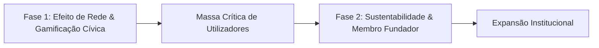

# Roadmap Estratégico — Projeto Sentinela

Este documento estabelece o plano diretor de desenvolvimento da aplicação Sentinela para as Fases 1 e 2. O foco centra-se na consolidação do efeito de rede, na retenção de utilizadores através de incentivos cívicos e na criação de sustentabilidade financeira sem recurso a publicidade.

---

---

## Fase 1 (Fase Atual): Efeito de Rede, Retenção e Gamificação Cívica

### Objetivo Principal
Criar densidade crítica de dados e tornar a aplicação indispensável nas deslocações diárias a pé e de carro. Em plataformas de segurança colaborativa, a utilidade do sistema aumenta exponencialmente com o número de cidadãos ativos a partilhar e validar ocorrências em tempo real.

> [!IMPORTANT]
> **Princípio Orientador:** O acesso à plataforma permanece integralmente gratuito, universal e sem qualquer anúncio publicitário, garantindo a máxima adesão nas cidades de lançamento piloto.

---

### Funcionalidades Consolidadas no Sistema
* Algoritmo de rotas seguras com desvio automático de ocorrências ativas e ruas mal iluminadas (motores Valhalla e OSRM).
* Modo de simulação de percurso passo a passo com avanço automático e manual para planeamento antecipado.
* Sinalização comunitária de sete categorias de ocorrências urbanas com confirmação e resolução em tempo real.
* Modo de acompanhamento em direto («Estou a ser seguido») com transmissão cifrada para a rede de contactos de confiança.
* Acionamento de alerta SOS com envio imediato de coordenadas geográficas e morada aproximada via SMS e WhatsApp.
* Mapeamento georreferenciado de postos policiais (PSP e GNR) e farmácias com verificação de horário em tempo real.

---

### Desenvolvimentos Previstos para a Fase 1

#### 1. Sistema de Pontuação Colaborativa (Autor e Validador)
* **Conceito:** Incentivar a vigilância cívica premiando tanto quem reporta inicialmente uma situação como quem a valida no terreno.
* **Mecânica de Atribuição de Pontos:**
  * **Autor do Alerta:** Recebe a maior fatia da pontuação (exemplo: 10 pontos por cada confirmação recebida de outro utilizador), recompensando a iniciativa e a utilidade da informação prestada.
  * **Validador (Utilizador que confirma):** Recebe também uma bonificação (exemplo: 3 pontos por validação fidedigna), incentivando a comunidade a verificar os alertas circundantes e a manter o mapa rigoroso.
  * **Resolução Cívica:** A quem sinaliza que um obstáculo ou perigo já foi resolvido é atribuída uma bonificação de civismo (exemplo: 5 pontos).
* **Mecanismos Anti-Fraude:**
  * Validação apenas permitida se o utilizador se encontrar no raio geográfico da ocorrência.
  * Limite diário de pontuações entre os mesmos utilizadores para impedir conluios ou reportes artificiais.

#### 2. Loja Cívica: Desbloqueio de Avatares e Marcadores de Posição
* **Conceito:** Permitir que os pontos acumulados sejam utilizados como moeda interna para personalização estética, gerando lealdade e retenção contínua.
* **Itens Desbloqueáveis:**
  * **Avatares de Perfil:** Estilos de ilustração exclusivos, insígnias temáticas e patentes cívicas representativas do nível de contribuição na cidade.
  * **Marcadores de Posição no Mapa (Pucks de Navegação):** Substituição do cursor padrão de navegação por ícones temáticos personalizados à escolha do utilizador:
    * Veículos estilizados (carros urbanos, motas, trotinetes).
    * Figuras e silhuetas personalizadas de caminhantes.
    * Objetos icónicos de segurança e orientação.

#### 3. Mecanismo de Convite Direto («Adicionar um Sentinela»)
* **Problema:** O acompanhamento de trajetos e a receção de alertas de perseguição ganham máxima eficácia se os contactos próximos tiverem a aplicação instalada.
* **Solução:**
  * Geração de ligações de convite direto por mensagem de texto ou WhatsApp com parâmetros de associação automática.
  * Ao abrir a ligação, os dois utilizadores ficam instantaneamente interligados na lista mútua de proteção.

#### 4. Apresentação Inicial Guiada (Onboarding em Três Passos)
* **Solução:**
  * Apresentação resumida na primeira utilização com explicação clara dos três pilares práticos:
    1. Escolha de rotas protegidas em detrimento do trajeto mais curto.
    2. Como reportar e confirmar alertas na via pública para acumular pontos.
    3. Definição da rede de contactos de emergência.

---

### Critérios de Transição para a Fase 2
1. Pelo menos 20 a 30 confirmações semanais validadas por utilizadores independentes nas zonas de teste.
2. Taxa de retorno semanal superior a 40% nas deslocações de regresso a casa.
3. Mais de metade da base de utilizadores ativos com pontos acumulados e avatares personalizados desbloqueados.

---

## Fase 2: Sustentabilidade Comunitária e Reconhecimento de Pioneiros

### Objetivo Principal
Assegurar a cobertura integral dos custos de servidores, serviços de mapas e envio de comunicações de emergência, permitindo aos cidadãos contribuir voluntariamente para a continuidade da infraestrutura pública.

> [!NOTE]
> **Princípio Orientador:** A monetização é estritamente opcional. Não existem bloqueios de segurança básica nem funcionalidades vitais reservadas a pagamentos. O apoio financeiro traduz-se em distinção cívica e reconhecimento dentro da comunidade.

---

### Desenvolvimentos Previstos para a Fase 2

#### 1. Módulo de Contribuição Voluntária («Apoiar o Sentinela»)
* **Localização:** Secção autónoma nas Definições da aplicação.
* **Níveis de Contribuição Única:**
  * **1,00 €** — Apoio Base de Segurança.
  * **2,50 €** — Cobertura Mensal de Infraestrutura de Bairro.
  * **5,00 €** — Patrono Comunitário Sentinela.
* **Processamento de Pagamento Integrado:**
  * **Google Play:** Pagamento imediato através da conta de aplicações Android.
  * **MB WAY / Referência Multibanco:** Integração direta e sem fricção adaptada ao mercado português.

#### 2. Atribuição da Insígnia «Membro Sentinela Fundador»
* **Reconhecimento no Perfil:**
  * Atribuição de uma insígnia dourada permanente no ecrã de perfil do utilizador.
* **Autoridade Comunitária nos Reportes:**
  * Os alertas criados por um Membro Fundador passam a exibir um elemento visual distintivo no mapa e na ficha informativa do incidente, sinalizando aos restantes utilizadores que o alerta provém de um apoiante verificado.
* **Privilégios de Cortesia:**
  * Inclusão do nome (se autorizado) no painel de honra e agradecimentos do projeto.
  * Acesso antecipado a novas funcionalidades experimentais antes da disponibilização geral.

#### 3. Painel de Transparência Operacional
* **Conceito:** Publicação de indicadores em tempo real que demonstram o destino dos fundos angariados.
* **Indicadores Apresentados:**
  * Percentagem mensal de despesas de servidor e mapas asseguradas pelas contribuições cívicas.
  * Total de alertas mantidos ativos e pessoas protegidas através da infraestrutura sustentada pela comunidade.

---

## Resumo Comparativo das Fases

| Vetor de Análise | Fase 1 (Atual) | Fase 2 |
| :--- | :--- | :--- |
| **Prioridade Operacional** | Adoção em escala, validação de alertas e gamificação | Autossuficiência de custos e consolidação comunitária |
| **Modelo Financeiro** | 100% Gratuito | 100% Gratuito com Micro-Doações Voluntárias (1€, 2.5€, 5€) |
| **Incentivos ao Utilizador** | Pontos por reportes e confirmações; desbloqueio de avatares e cursores | Insígnia de Membro Fundador e autoridade cívica nos reportes |
| **Presença de Publicidade** | Nenhuma | Nenhuma |
| **Destino dos Pontos** | Personalização de avatares, veículos e marcadores de posição no mapa | Continuidade da progressão aliada ao estatuto de apoiante |
| **Resultado Esperado** | Efeito de rede robusto e dados urbanos de elevada qualidade | Infraestrutura auto-sustentada pronta para parcerias institucionais |
